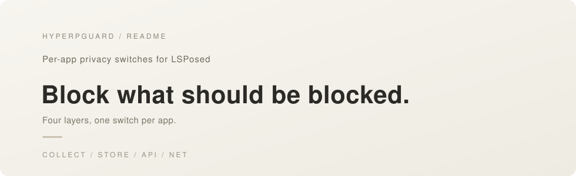

<p align="center">
  
</p>

<h1 align="center">HyperPGuard</h1>

<p align="center">
  <a href="https://github.com/vivibibi30/hyperpguard/releases"></a>
  
  
  <a href="LICENSE"></a>
  
</p>

## About

**An LSPosed module that puts per-app switches on four kinds of app behaviour — data source queries, local storage writes, IPC interfaces and network egress. Rules are user-defined (domain suffix + path, class#method); switches that could affect app features default to off. It runs entirely on-device and has no network access of its own.**

This project is based on static analysis and runtime observation of the components shipped on the author's own device. Components differ between models and ROM versions; treat everything here as observed behaviour, not as a universal description.

> [!IMPORTANT]
> For personal study and research on devices you own; read [DISCLAIMER.txt](DISCLAIMER.txt) first. "Hyper" refers to the HyperOS platform — this project is not affiliated with Xiaomi, China Unicom, or any vendor mentioned.

<p align="center">
  <a href="README.md" title="Switch to 简体中文"><picture><source media="(prefers-color-scheme: dark)" srcset="docs/images/language-zh-inactive-dark.svg"></picture></a><a href="README.en.md" title="English · current language"><picture><source media="(prefers-color-scheme: dark)" srcset="docs/images/language-en-active-dark.svg"></picture></a>
</p>

<p align="center">
  <picture>
    <source media="(prefers-color-scheme: dark)" srcset="docs/images/cover-en-dark.svg">
    
  </picture>
</p>

## Requirements

- Android 10 – 16 on HyperOS / MIUI, LSPosed 2.2.x (libxposed API 100+)
- Root for the in-app "restart" and "view log" actions (KernelSU, Magisk, APatch)

## Install

1. Install `HyperPGuard.apk` from [Releases](https://github.com/vivibibi30/hyperpguard/releases)
2. Enable the module in LSPosed
3. Open the app once; it requests the full scope through the official libxposed API, or pick packages manually in LSPosed
4. Press "restart" on a card, or "restart all", so the target process reloads with the module

Packages outside the scope are never injected.

After an in-place upgrade, LSPosed does **not** automatically add newly declared components to the scope. Re-check LSPosed → Modules → HyperPGuard → Scope; the components added in 1.6.x are "Ads (MSA)" and "Diagnostics (MiSight)". When one is missing, its card shows "Not in scope — tap to add".

## Usage


- **Group switch**: the toggle in the card header mirrors that package's LSPosed scope state. Turning it on requests scope through the framework API; if the framework refuses, a dialog explains what to tick manually.
- **Sub-switches**: "on" means the behaviour is blocked. Rules that can affect system features default to off, and the subtitle states the cost.
- **Hot reload**: changing a switch no longer needs a restart. The module asks the framework to hot-reload the injected processes (libxposed API 102), only those affected. The "Hot reload" switch on the home page can turn this off and fall back to manual restart.
- **Restart**: applies `am force-stop` to the target package so it reloads with the new rules. System components are usually restarted by the system within seconds.
- **Data self-check**: the home page shows the Security Center behaviour-DB write counter and a read-only MiSight event DB browser (needs root; copies the DB, queries it, then deletes the copy; nothing is exported).
- **Settings page**: view/share logs (with a per-host block summary), clear the log buffer, hide the launcher icon, import/export the config; the About section (repo, LSPosed page, issues, version, update check) sits at the bottom.
- **Custom rules**: append extra blocking by domain, `domain/path`, or `class#method`. See [docs/CUSTOM-RULES.md](docs/CUSTOM-RULES.md) (Chinese).
- **Log unblocked hosts**: records hosts that matched no rule, for finding missing rules; keep it off normally.

The UI follows the system language: English on English devices, Chinese otherwise. Log text and diagnostics remain Chinese.

## What is intercepted

Four stages along the data path, plus a method-layer fallback for when obfuscated names change:

| Stage | Approach |
|---|---|
| Collection entry | Cuts at the source: installed-app lists, usage records, device identifiers, location and network-environment queries return empty |
| Local storage | Blocks writes to the behaviour-record database, so nothing can be packaged for upload |
| Cross-process interfaces | Blocks query and scoring interfaces so third-party apps cannot read those records |
| Network egress | Hooks host resolution and connections inside the target process; rules are "host suffix + optional path prefix" |
| Fallback | Resolves specific methods by signature and returns constants; when names change, the network layer still works |

The stages are independent: if one breaks on a component update, the others keep working, and the log shows which stage matched.

## Scope

Grouped by capability rather than listing target packages; each switch in the UI states exactly what it covers on your device.

| Category | What is blocked |
|---|---|
| Telemetry | Upload events from analytics components, covered at both the method and the domain layer |
| Device and location | Device identifiers, cell and Wi-Fi scans, location queries — per-app switches, off by default |
| Behaviour records | Writes of screenshot / call / screen-share records, plus the query and scoring interfaces that expose them |
| Diagnostics | Log upload for system diagnostics and remote after-sales diagnosis; triggering requires a user-initiated report or after-sales action, local records are not the same as uploaded ones |
| Carrier side | Report domains and methods of the carrier device-management component; reporting is blocked, granted permissions are not revoked |
| Input methods | Telemetry, clipboard capture, voice upload |
| Ads and store | Ad usage profile, splash ads, config delivery and telemetry |

Each app is one card in the UI: the switch in its top-right corner is its LSPosed scope switch, and per-item rules sit inside. Rules that can affect system features default to off, with the cost stated in the subtitle.

## Logs

| Prefix | Meaning |
|---|---|
| `attach <process>` | Module injected into a process |
| `X(host)` / `X(host+path)` | A rule matched; path rules log `X(host+path)`, so grep with `grep -F 'X(host'` |
| `X(strict)` | Whole-process blocking active |
| `? <tag> <host>` | "Log unblocked hosts" record: request was not blocked |
| `hook ok` / `hook miss` | Method hook installed / target not found |
| `xsof provider hooked`, `xsof aidl hooked=N`, `xsof db write hooked=N`, `xsof score hooked=N` | XSOF layers |
| `msa usage opened=… lastUsed=…`, `msa track hooked=N` | MSA hooks |
| `hookBySignature skipped classes=N` | Classes whose signatures could not be resolved were skipped, scanning continued |

### Verifying it works

1. Enable the module and restart the target app
2. Trigger its reporting (open Security Center, install an app)
3. "View log" should show `attach <process>` and `X(...)` lines
4. XSOF lines should all say `hooked`, with no `miss`
5. If only `attach` appears, enable "log unblocked hosts" for a while and add the `?` hosts to the rules

## Build

JDK 17 and build-tools 35+ are required. There is no Gradle; `build.sh` runs `javac --release 11` → `d8` → `aapt2 link` → `zipalign` → `apksigner`.

```sh
export ANDROID_JAR=/path/to/android.jar D8=/path/to/d8 AAPT2=/path/to/aapt2
export ZIPALIGN=/path/to/zipalign APKSIGNER=/path/to/apksigner
sh build.sh
```

## Source layout

```
src/io/github/vivibibi30/hyperpguard/
├── HookEntry.java       entry point, dispatch per package
├── Config.java          switches and config channel
├── I18n.java            UI strings (Chinese source, English lookup)
├── NetGuard.java        URL / InetAddress / Socket + rule matching
├── PrivacyApis.java     app list, usage stats, identifiers, SMS, XMSF
├── CaptureHooks.java    behaviour database writes, silent recording
├── XsofHooks.java       XSOF provider / AIDL / writes / scoring
├── MsaHooks.java        MSA usage profile and OneTrack
├── AnalyticsHooks.java  analytics method layer
├── Hooks.java           shared hook helpers
├── Logs.java            unified log tag
├── PgSwitch.java        MIUI-style switch used by the settings UI
└── MainActivity.java    settings UI
```

## Limitations

- Domain lists can be incomplete: addresses can be delivered from server config
- Switches left at their default value are not written into `hyperpguard_conf`; a missing key does not mean the switch is off
- Obfuscated class names change between versions; `hook miss` in the log is expected and does not affect the network layer
- Requests made through native stacks (Cronet and friends) are not covered by Java-level hooks
- `IMrm` is a HAL-level service; only the `ServiceManager` side is disconnected
- The module blocks reporting; it does not revoke permissions already granted during device setup

## Contributing

> **Maintenance**: this is a personal project. Development and testing rely on AI assistance and self-funded device testing, so the cost is borne by the author alone. Releases happen only for defects that affect use, newly discovered reporting channels, or adaptation to a new major system version. UI and wording changes are folded into the next substantive release instead of shipping on their own. Issues are read, but no response time or delivery schedule is promised.

Run "self-check" before opening an issue, redact identifiers in logs, and read [CONTRIBUTING.en.md](CONTRIBUTING.en.md) for what not to upload (vendor APKs, decompiled output, device databases).

## License and disclaimer

GPL-3.0, see [LICENSE](LICENSE). Usage terms, legal notes and risk statements are in [DISCLAIMER.txt](DISCLAIMER.txt); the English summary there is for convenience only and the Chinese text prevails. Please read it before use. The project is not affiliated with Xiaomi or China Unicom, and all trademarks belong to their respective owners.

## Credits

HyperCeiler, XSOF Privacy, HyperOS4-XSOF-Analysis, OSAKOo, RooyCo, frauddb, misight-viewer, compose-miuix-ui/miuix, libxposed, LSPosed and others. The floating bottom bar's dimensions and motion parameters reference the compose-miuix-ui / miuix example (Apache-2.0), re-implemented from parameters; see [NOTICE](NOTICE). The full list with links is in the [Chinese README](README.md#参考来源).
