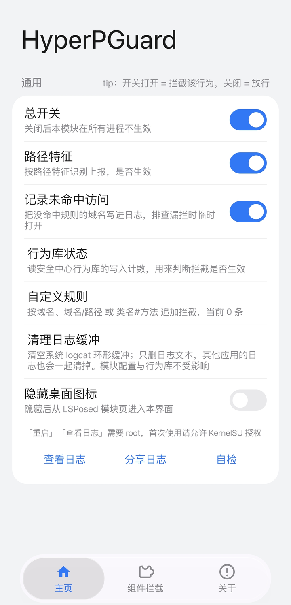

<div align="center">

# HyperPGuard


在采集入口、本地存储、对外接口、网络出口四层拦截 HyperOS 预装组件的隐私上报

</div>

[简体中文](README.md) · [English](README.en.md)

以下内容基于对本机预装组件的静态分析与运行时观察：这些组件会采集设备标识、应用使用记录、位置、通话行为等信息，并通过网络或跨进程接口发出。本模块在这些通道上按应用分组拦截，开关与 LSPosed 作用域联动。具体行为以各自机型和系统版本上的观察为准。

> **维护节奏**：本项目由个人维护，开发与验证主要依赖 AI 辅助与自费的真机测试，长期成本由作者个人承担。更新频率已主动下调：只在出现影响使用的缺陷、发现新的上报通道或系统大版本适配时发版；界面、文案与小功能改动会并入下一次实质更新，不单独出包。issue 会看，但不承诺响应时间和实现排期，未确认的功能请求可能长期不做，或并入相近的改动一起处理。

改代码前建议先看 [AGENTS.md](AGENTS.md)（协作约定）与 [docs/ARCHITECTURE.md](docs/ARCHITECTURE.md)（结构与扩展步骤）。

本仓库即源码仓：`src/` 下是全部 Java 实现，`build.sh` 是完整构建脚本，用 `javac` + `d8` + `aapt2` + `zipalign` + `apksigner` 打包，不依赖 Gradle；`Releases` 里的 APK 由它构建。`Xposed-Modules-Repo/io.github.vivibibi30.hyperpguard` 只是 LSPosed 的索引仓库，只放 APK 与简介。

> 仅供个人在自有设备上学习研究使用。使用前请阅读 [DISCLAIMER.txt](DISCLAIMER.txt)。名称中的 Hyper 指 HyperOS 平台，本项目与小米、中国联通等厂商无隶属或合作关系。

## 当前支持的版本

- Android 10 – Android 16 的 HyperOS
- LSPosed 2.2.x（libxposed API 100+）
- Root：KernelSU / Magisk / APatch（「重启」「查看日志」需要）

## 安装

1. 安装 `HyperPGuard`
2. 在 LSPosed 中启用「HyperPGuard」
3. 打开应用，首次会向 LSPosed 请求全部作用域，允许即可；也可在 LSPosed 里手动勾选
4. 在模块里对目标应用点一次「重启」，或点批量行的「全部重启」，让它重新加载

作用域外的应用不会被注入。

覆盖升级后，LSPosed 的作用域不会自动包含新增组件，需要到 LSPosed → 模块 → HyperPGuard → 作用域 里重新确认；漏勾时对应分组会显示「未在作用域，点此加入」，本机没有安装的组件会显示「本机未安装该组件」。

## 使用

<p align="center">
  
</p>

**分组开关**：每张卡片右上角是该应用的开关，等同于它在 LSPosed 里的作用域开关。组关闭时组内子项置灰不可操作。

**子项开关**：可以只留某条规则，例如只要 XSOF 拦截就把域名层那项关掉。会影响系统功能的规则一律默认关闭，副标题写明代价。

**自定义规则**：内置表没覆盖的域名可以自己补，支持「域名」「域名/路径」和「类名#方法」三种写法：前两种作用于网络出口，第三种让指定方法直接返回默认值，用于内置 hook 因类名变化失配时应急。添加后需重启对应应用才生效。写法、匹配方式与限制见 [自定义规则使用说明](docs/CUSTOM-RULES.md)。

**重启**：改完开关点「重启」执行 `am force-stop`，应用下次启动重新注入；批量行有「全部重启」。系统常驻组件被停止后通常几秒内会被系统拉起，等于自动完成重启。

**查看日志 / 分享日志**：读取本地 logcat 中本模块的输出，可导出分享。日志不包含电话号码、行为库内容或调用参数。

**记录未拦截访问**：记录「访问了但没被规则命中」的域名，用于补规则，平时保持关闭。

**关于 / 检查更新**：卡片底部列出 GitHub 仓库、LSPosed 模块页与 Issues 入口，点「检查更新」会向 GitHub API 取最新 release tag 与当前版本比对；不点就不发任何请求。

## 拦截层次

按数据处理顺序分四层，方法层作为类名失配时的兜底：

| 层 | 做法 |
|---|---|
| 采集入口 | 在数据来源处截断：应用列表、使用记录、设备标识、位置与网络环境查询直接返回空 |
| 本地存储 | 拦截行为记录类数据库的写入，写不进去也就无从打包上传 |
| 对外接口 | 拦截跨进程查询接口与风险评分接口，第三方应用拿不到这些记录 |
| 网络出口 | 拦截目标进程内的域名解析与连接，按「域名后缀 + 可选路径」匹配 |
| 兜底 | 反射定位特定方法后返回默认值；类名随版本变化时，网络层仍然生效 |

四层互不依赖：某层因版本变化失效时其余层照常工作，日志能分辨是哪一层命中。

## 覆盖范围

按能力分类，不逐一列出目标组件与包名；需要精确拦截范围时，请在自己的设备上对照界面里每个开关的描述。

| 类别 | 拦的是什么 |
|---|---|
| 统计与埋点 | 统计类组件的上报事件，方法层与域名层各有一条路径 |
| 设备与位置 | 设备标识、基站与 Wi-Fi 扫描、定位查询按应用单独开关，默认关闭 |
| 行为记录 | 截图、通话、屏幕共享等行为记录的写入，以及对外的查询与评分接口 |
| 诊断与反馈 | 系统诊断与售后远程诊断的日志上传；触发条件是用户主动反馈或售后操作，本地记录不等于已上传 |
| 运营商侧 | 设备管理组件的上报域名与方法层，只拦上报，不回收已授予的权限 |
| 输入法 | 统计上报、剪贴板内容记录、语音数据上传 |
| 广告与商店 | 广告使用画像、开屏广告、配置下发与统计上报 |

每个应用在界面里是一张卡片：右上角是它在 LSPosed 里的作用域开关，卡片内是逐项规则，会影响系统功能的规则默认关闭并在副标题写明代价。

## 日志说明

| 前缀 | 含义 |
|---|---|
| `attach <进程>` | 模块注入某进程成功 |
| `X(host)` | 域名规则命中；带路径规则时是 `X(host+path)`，grep 建议用 `grep -F 'X(host'` |
| `X(host+path)` | 域名 + 路径规则命中 |
| `X(strict)` | 整进程断网生效 |
| `? <tag> <host>` | 「记录未拦截访问」记录：访问未被拦截 |
| `hook ok` / `hook miss` | 方法层安装成功 / 类名或签名不匹配 |
| `xsof provider hooked` | XSOF Provider 三个入口已拦截 |
| `xsof aidl hooked=N` | XSOF AIDL 接口拦截数量 |
| `xsof db write hooked=N` | XSOF 写库方法拦截数量 |
| `xsof score hooked=N` | 风险评分方法拦截数量 |
| `analytics scan scanned=N hooked=N` | analytics 签名扫描结果 |

## 如何确认生效

1. 启用模块，并对目标应用点一次「重启」
2. 触发一次它的上报行为（例如打开安全中心、安装一个应用）
3. 点「查看日志」，应看到 `attach <进程>` 与 `X(...)` 记录
4. XSOF 部分应全是 `hooked`，没有 `miss`
5. 只有 `attach` 没有 `X(...)` 时，打开「记录未拦截访问」跑一段时间，把 `?` 开头的域名补进规则

## 构建

需要 JDK 17 与 build-tools 35 及以上，SDK 路径用环境变量指定：

```sh
export ANDROID_JAR=/path/to/android.jar D8=/path/to/d8 AAPT2=/path/to/aapt2
export ZIPALIGN=/path/to/zipalign APKSIGNER=/path/to/apksigner
sh build.sh
```

## 源码结构

```
src/io/github/vivibibi30/hyperpguard/
├── HookEntry.java      入口与按包分发（XposedModule#onPackageReady）
├── Config.java         开关常量
├── NetGuard.java       网络出口：URL / InetAddress / Socket + 规则匹配
├── PrivacyApis.java    隐私 API：应用列表 / 使用记录 / 标识 / 短信 / XMSF 广播
├── CaptureHooks.java   行为库写入与静默录屏
├── XsofHooks.java      XSOF Provider / AIDL / 写库 / 评分 + MRM
├── AnalyticsHooks.java 统计方法层与签名扫描
├── Hooks.java          公共 hook 工具
├── Logs.java           统一日志标签
└── MainActivity.java   设置界面
```

```
res/values/           app_name 等字符串资源
assets/               免责声明
META-INF/xposed/      模块声明（必须打到 APK 根）
libs/libxposed-api.jar       libxposed API（compileOnly，不打进 dex）
libs/libxposed-service.jar   service + interface 合并版（必须打进 dex）
libs/api-82.jar              传统 Xposed API（编译兼容用）
docs/                 技术笔记、规则说明、截图
build.sh              一键构建
```

新增组件、规则或界面改动的步骤见 [docs/ARCHITECTURE.md](docs/ARCHITECTURE.md)。

## 适配边界

- 开关保持默认值时不会写进 `hyperpguard_conf`，`settings get` 里缺某个 key 不代表它关闭，以界面状态与日志为准
- 域名名单可能漏项：地址可由配置下发；小米统计为整进程断网，SystemHelper 默认只拦上报域名，其余组件依赖隐私 API 层与方法层
- 方法层类名随组件版本变化，日志里 `hook miss` 属正常，网络层与隐私 API 层不受影响
- 使用 native 网络栈（Cronet 等）的请求不受 Java 层 hook 影响
- `IMrm` 属 HAL 层，仅从 `ServiceManager` 侧断开
- 部分代发链路属于跨进程交接，只拦模块自身作用域覆盖不到的那一段
- 拦截范围限于已识别的通道，不代表覆盖 HyperOS 全部联网行为
- 运营商侧组件的权限在新机激活（OOBE）阶段授予，激活时的权限弹窗值得逐项看清；本模块只拦上报，不回收已授予的权限。对授权有疑虑时，可在设置里找「隐私与安全 / 反馈 / 用户体验计划」这类入口，或备份后重置手机重走开机引导
- 识别结论以静态分析与真机行为对照为准，单看一段静态代码不足以定性
- 安全组件里的反诈逻辑用于通话场景，运营商侧组件承担的是设备管理侧的上报，两者不是同一条链路

## 常见问题

- **某个应用开关打不开**：该包可能不存在、被冻结或与系统共享 UID，LSPosed 无法把它加入作用域
- **日志为空**：`logcat` 环形缓冲已覆盖，或目标应用还没重启过
- **功能异常**：对应的默认关闭子项被打开了，按需关掉即可
- **方法层出现 `hook miss`**：组件版本变化，网络层与隐私 API 层不受影响

## 反馈与边界

- 提 issue 前先点「自检」，日志脱敏后再贴；具体见 [CONTRIBUTING.md](CONTRIBUTING.md)
- 不要上传厂商组件的 APK 或反编译产物到 issue，需要分析时请自行在设备上定位
- 本项目不做付费分发，也不提供「赞助解锁功能」；第三方 fork 按 GPL-3.0 自行处理

## 更新日志

### 1.8.9

- 「全部重启」只重启真正在运行的应用，没运行的不动，提示里说明跳过了几个；全都没在跑就直接说无需重启
- 单组「重启」同样处理：应用没在运行就不 force-stop，下次启动本来就会加载新配置

### 1.8.8

- 新增微信输入法分组：统计埋点、崩溃与性能上报默认开；云输入与词库默认关
- 新增豆包输入法分组：统计埋点默认开；配置与校验、云输入服务默认关
- 修搜索漏匹配：分组标题与说明也进索引，搜「输入法」能命中全部六个输入法分组

### 1.8.7

- 修 1.8.6 的按钮配色：「清空行为库」被对话框统一样式刷成正文色，现在与「刷新」同为主题蓝
- 按钮改为竖排（清空在上、刷新在下），按压范围收到「文字 + 左右 24dp」，不再整行变色

### 1.8.6

- 「清空行为库」按钮改为与「刷新」相同的主题蓝，按钮布局不变；清空逻辑与 1.8.5 一致

### 1.8.5

- 「行为库状态」弹窗新增「清空行为库」：二次确认后停止安全中心并删除行为库文件，计数归零，库会在下次有记录时重建
- 清空后读不到库属正常；本模块的开关与拦截不受影响

更早版本见 [Releases](https://github.com/vivibibi30/hyperpguard/releases) 与 `docs/RELEASE-<版本>.md`。

## 参考来源

以下项目的公开资料提供了识别目标与验证思路。本项目代码独立编写，未复制、未反编译复用其实现。

- **[HyperCeiler](https://github.com/ReChronoRain/HyperCeiler)**（GPL-3.0，作者 [Sevtinge](https://github.com/Sevtinge)，现维护于 [ReChronoRain](https://github.com/ReChronoRain)）— 统计组件的目标方法、安装器的上报路径、方法层匹配与 MRM 拦截思路
- **[XSOF Privacy](https://github.com/yunyizea/xsof-privacy)**（作者 yunyizea）— 8 类行为记录的拦截范围、`(null, 1017)` 拒绝语义、按组组织 hook
- **Hyper 隐私卫士**（`io.github.hyperprivacyguard`）— SystemHelper 采集入口特征、guardprovider 应用列表采集
- **[HyperOS4-XSOF-Analysis](https://github.com/FAQQAQ/HyperOS4-XSOF-Analysis)**（作者 [FAQQAQ](https://github.com/FAQQAQ)）— 7 个组件的静态分析记录：上报域范围与区域备份域、DoH 重试、明文上报链路、统计组件的内部结构
- **[OSAKOo](https://www.coolapk.com/feed/74882729?s=MzNlYzk4NWUxNWZhMjRnNmFlZTFjMDJ6a1664)**（酷安）— 行为库的表结构与拼写特征、截屏接口的调用方式、视频上报链路、运营商侧组件的采集项与实际用途
- **[Android OS Privacy Under the Loupe – A Tale from the East](https://ar5iv.labs.arxiv.org/html/2302.01890)**（ACM WiSec '23）— 四类敏感数据的分类，以及设备标识、位置、通讯录在预装组件里的采集面
- **酷安 [RooyCo《真问题还在》](https://www.coolapk.com/feed/74911090)** — 运营商 DM 组件的存在与采集字段（Wi-Fi 列表、蓝牙、BSSID、路由器 MAC）、采集频率与开关项
- **[frauddb](https://github.com/acnekot/frauddb)**（acnekot，MIT）— 行为库的表结构、库路径与号码摘要算法
- **[hyperos-dm-report](https://github.com/acxun/hyperos-dm-report)**（作者 [acxun](https://github.com/acxun)，文档 CC BY 4.0）— 运营商 DM 组件的上报链路与加密方式、诊断组件的事件日志域名；本文只引用其结论，未复制原文
- **[misight-viewer](https://github.com/Artriai/misight-viewer)**（作者 [Artriai](https://github.com/Artriai)）— 诊断组件的数据库字段与事件分类、设备诊断与用户行为记录的区分依据
- **[KernelSU](https://github.com/tiann/KernelSU)**（GPL-3.0，作者 [tiann](https://github.com/tiann) 与贡献者）— 1.7.0 悬浮底栏的尺寸与配色、`DampedDragAnimation` 的弹簧与按压时序、`MainPagerState` 的翻页同步判据；仅对照参数重写，未复制源码
- **[compose-miuix-ui / miuix](https://github.com/compose-miuix-ui/miuix)**（Apache-2.0）— `PagerNavigationSpringSpec` 与 `IosLiquidGlassNavigationBar` 示例，KernelSU 的浮动底栏即由该示例改写而来
- **libxposed API**（Apache-2.0）、**LSPosed** — 模块入口与作用域接口

第三方组件：`libxposed API 102`（Apache-2.0，编译期依赖），详见 [NOTICE](NOTICE)。

感谢以上作者与维护者。

## 免责声明

- 本模块仅用于在**本人拥有完全控制权**的 Android 设备上限制预装组件的上报行为，不提供任何入侵、破解他人系统或获取他人数据的能力
- 作者不参与、不支持商业销售、付费分发或捆绑获利；第三方分发须遵守 GPL-3.0
- 模块默认不联网、不收集、不上传任何信息；仅在手动点设置页「检查更新」时向 GitHub API 查询一次版本号，不发送任何设备标识或使用数据；开关配置存在本地，日志只在本地 logcat 读取
- 「自定义规则」由使用者自行填写，其中方法级规则会直接改变目标进程内方法的返回值；模块不提供任何预置方法级规则，由此产生的应用异常或功能失效由使用者承担
- 模块名称、包名、图标归作者所有，不得冒充官方版本
- 与小米、中国联通等厂商无隶属或合作关系，商标归各自权利人；界面对 KernelSU、compose-miuix-ui 的参考仅为实现思路，不代表其作者认可或背书本项目
- 分析结论来自对自己设备上已安装组件的公开行为观察（网络请求、日志、界面），不包含厂商私有文档、未公开源码或内部数据
- 如权利人认为本项目某项描述或实现不当，可通过 Issues 或仓库主页的联系方式提出，我们会核实后调整或移除
- 按「现状」提供，不提供任何明示或暗示担保

完整九条条款见 [DISCLAIMER.txt](DISCLAIMER.txt)；文件中附有英文摘要，仅供阅读，与中文正文冲突时以中文为准。

## 许可

GPL-3.0，见 [LICENSE](LICENSE)。

## English

HyperPGuard is an LSPosed module for HyperOS that blocks telemetry from preinstalled system components — carrier telemetry, cloud app scanning, installer stats, ads, XSOF behaviour queries and silent screen recording — at four stages: data source, local storage, IPC interfaces and network egress. Per-app switches, feature-affecting rules default off. Requires Android 10+, LSPosed 2.2.x and root for restart/log features.

The settings UI follows the system language: English when the device language is English, Chinese otherwise. Logs and diagnostic text remain Chinese. Personal use only. See [DISCLAIMER.txt](DISCLAIMER.txt). GPL-3.0.
